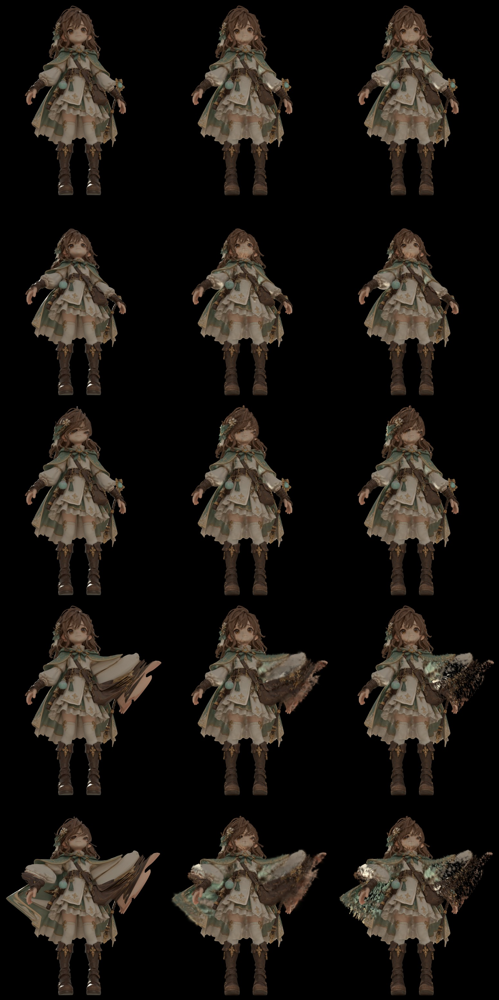

# 09 メッシュ連動ガウシアン層（T9）

## 目的
アニメーション（骨でメッシュを動かす）に、3DGSの描画がついてくるかを確かめる。
docs/07-overview.md §5 の推奨案に従い、Gaussian Frosting の考え方だけを借りて自前で実装した（コードは参照していない）。
キャラクターのきれいな Tripo メッシュの三角形にガウシアンを結びつけ、メッシュを変形したときに位置・向き・大きさが一緒に動くようにする。

## 方法
- メッシュ: Tripo の GLB（足元原点・前方 -Y・1.2 m）を 12 万面に簡略化（`scripts/t9/prep_mesh.py`）。頂点色は元テクスチャから最近傍で写した。
- ガウシアン: 約 46 万個を三角形の面積に比例して配る（間隔 2.3 mm）。各ガウシアンの持ち物は「所属する三角形、三角形内の重心座標、法線方向のずれ h、三角形の局所座標での回転と大きさ、色(SH0)、不透明度」。
  - 世界座標の姿勢は三角形の枠（辺 → 接線、法線）から作る。頂点が動けば位置・向き・大きさが自動で追従する（`scripts/t9/meshgs.py`）。
- 描画は gsplat 1.5.3（Apache-2.0）、学習ループは自前（`scripts/t9/train.py`）。損失は L1 + 0.2·(1−SSIM) + 法線ずれの正則化。メッシュは固定、学習するのはずれ・回転・大きさ・色・不透明度のみ（密度の増減は無し）。
- 教師データ: T8 のマスター描画（2048²、288視点）を 1024² に縮小して使用。評価は test 36 視点（k%8==0）の人物まわり（ROI）。
- 変形の確認（`scripts/t9/deform.py`, `animate.py`, `render_pose_ref.py`）: 骨の代わりの手続き的なスキニング（上半身を前に倒す、首から上を回す、腕を開く、手を振る）を、(a) ガウシアン層の三角形頂点、(b) Blender 上のテクスチャ付き元メッシュ、の両方に同じ関数で適用。(b) を Cycles で描画したものを正解とした。
  - 比較対象は「位置だけ移動」: 各ガウシアンを所属三角形の重心の移動量だけ平行移動し、向きと大きさは基準姿勢のままにしたもの。

## 結果

### 静止姿勢（1024²、12000 反復、約 14 分）
| 設定 | ガウシアン数 | PSNR | SSIM | LPIPS(vgg) |
|---|---|---|---|---|
| b05: 6 万面・30 万個 | 303k | 26.34 | 0.930 | 0.108 |
| c05: 12 万面・46 万個、ずれの学習率 ×5 | 460k | **26.71** | **0.939** | **0.094** |

c05 の内訳: 全身リング 26.6 dB / 上半身 27.8 dB / 顔の寄り 26.2 dB（LPIPS 0.150）。PLY は 30 MB（46 万個）。
T8（2048²、寄り視点、SH3）の数字とは解像度・次数が違うため直接は比べていない。同じ条件での比較は未実施。

### 変形への追従（c05、正解は元メッシュの Cycles 描画、ROI の PSNR）
| ポーズ | 視点0 層が追従 / 位置のみ | 視点3 層が追従 / 位置のみ |
|---|---|---|
| rest | 25.93 / 25.93 | 25.59 / 25.59 |
| lean（前傾20°） | 24.03 / 23.80 | 22.23 / 22.03 |
| head（首を40°回す） | 24.85 / 24.57 | 22.66 / 22.63 |
| arm_r（右腕を55°開く） | 23.41 / 19.34 | 16.52 / 15.50 |
| wave（両腕＋首＋前傾） | 21.56 / 18.26 | 15.92 / 14.99 |

- 層が追従する方が常に同じか良く、変形が大きいほど差が広がる（腕で最大 +4 dB）。基準姿勢では、静止ガウシアンが回転・拡大縮小に追従しない影響が出ないため同値。
- 画像: `docs/img/09-pose-sheet.jpg`（左から 正解 / 層が追従 / 位置のみ。上から rest, lean, head, arm_r, wave）。



## 気づいたこと・うまくいかなかった点
1. **腕を開くとマントが裂ける**: 腕の重みを骨の線分からの距離だけで作った粗いものにしたため、マントが巻き込まれて裂ける。これは正解の元メッシュ側でも同じ裂け方になるので、ガウシアン層の問題ではなく重みの問題。本物のリグ（Blender でウェイトを塗る）が必要。裂けた部分は層の方がぼやけ、位置のみ案は粒状にばらける。
2. **頭を回すと顔が白っぽく、髪がけばけばする**: 基準姿勢で顔はわずかにぼやけている。向きを変えると髪の房の層が顔の上に重なり、目が隠れ気味。メッシュに前髪の房が薄い板で乗っている構造と、1 面あたりのガウシアンが多層でないことが原因と思われる（原因の確認は未実施）。
3. **ライティングは基準姿勢で焼き込み済み**: 色は SH0（視点によらない色）なので、体を動かしても陰影は動かない。動的な光は別途（ファインチューン、または法線を使ったシェーディング）が必要。
4. **学習は 1024²・密度固定**: 寄りの視点の細部（2048²）、密度の増減（分割・削除）、SH は未対応。顔の LPIPS が 0.15 と高いのはこのため。
5. 途中のバグ: スケールの上限を絶対値で掛けたため小さい点だらけの描画になり PSNR 15 dB。1 個ごとの相対上限に直して解決。

## 結論と次の一手
方針変更: ユーザーの判断で当面は動きより静止画の精細度を優先するため、T9 は今回の結果で研究記録として一区切りにした（リグでの再検証は未実施・保留）。

- メッシュに結びつけたガウシアン層は、(a) 静止で 26.7 dB / SSIM 0.94 と実用的な画質、(b) メッシュ変形で位置・向き・大きさが追従し、位置だけ動かす案より常に良い、ことを確認した。「3DGSの質感でアニメーションできる」という核心部分は成立する。
- 次に効きそうなこと（優先順）:
  1. Blender で本物のリグとウェイトを作り、同じ検証を骨アニメで行う。
  2. 2048²・寄り視点で学習し、顔・髪のぼやけを改善する。密度の増減を入れる。
  3. 変形後の姿勢で追加の見えを教師にして、陰影の焼き込みを緩める。
  4. Unity（UnityGaussianSplatting）への取り込み: 層のガウシアンを毎フレーム三角形から再計算する必要があるので、GPU 側で更新する実装を検討する。

## 再現
```
scripts/wsl/setup_t9_env.sh                            # venv ~/venvs/t9 と gsplat のビルド
python scripts/t9/prep_mesh.py --glb <girl_healer.glb> --out experiments/T9/mesh_120k.npz --faces 120000
python scripts/t9/train.py --master <T8 master> --mesh experiments/T9/mesh_120k.npz --out experiments/T9/runs/c05_12k \
    --iters 12000 --scale 0.5 --n 450000 --lr_h 1e-3 --lam_off 0.01
# 正解の描画（Blender）: scripts/t9/run_pose_ref.ps1 → experiments/T9/ref/
python scripts/t9/animate.py --run experiments/T9/runs/c05_12k --master <T8 master> --mesh experiments/T9/mesh_120k.npz \
    --poses rest,lean,head,arm_r,wave --views ring:0,ring:3 --ref experiments/T9/ref --out experiments/T9/runs/c05_12k/anim
```
モデル(model.pt)・PLY・描画画像は `experiments/T9/`（Git管理外）。
